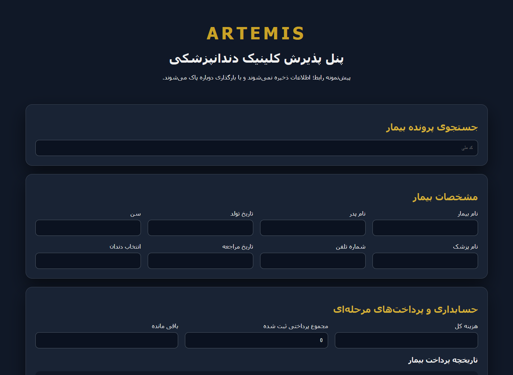

# Artemis Dental — نمونه رابط پذیرش | Reception UI prototype

نمونهٔ کوچک فارسی و راست‌به‌چپ از رابط پذیرش کلینیک دندان‌پزشکی با رنگ‌های سرمه‌ای و طلایی. این پروژه یک پیش‌نمونهٔ رابط است: افزودن ردیف پرداخت و جمع مبلغ‌های واردشده کار می‌کند؛ جست‌وجوی پرونده، ذخیره و ویرایش اطلاعات به سرور یا پایگاه داده متصل نیستند. اطلاعات با بارگذاری دوباره صفحه از بین می‌روند.

A small Persian, right-to-left dental reception interface with a navy/gold visual style. This is a UI prototype: adding payment rows and calculating their total work in React state. Patient search, saving and editing are not connected to a backend or database. Reloading clears entered values.



## اجرا | Run

Node.js **22.12 or newer** is required.

```sh
npm ci
npm run dev
```

Open the loopback URL printed by Vite. To produce and inspect the static build:

```sh
npm run build
npm run preview
```

## ساختار و امکانات | Structure and features

- React 19 + Vite 8; source is in `src/main.jsx` and `src/style.css`.
- RTL patient detail and treatment-note forms, responsive grid, expandable payment rows and a running payment total.
- No external image/font assets, authentication, persistent records, appointment engine or payment processing.

برای بررسی، `npm run build` را اجرا کنید و در پیش‌نمایش، دو ردیف پرداخت با مبلغ دلخواه اضافه کنید؛ جمع باید تغییر کند. دکمه‌های ذخیره و ویرایش غیرفعال‌اند چون در این پیش‌نمونه عملیاتی ندارند. CI نصب وابستگی‌ها و ساخت رابط را بررسی می‌کند؛ آزمون یکپارچهٔ سرور برای این پروژه وجود ندارد.

For a manual check, build and preview the app, add a second payment row, then change both amounts and verify the displayed total. Save/edit controls are disabled because persistence is not implemented. CI checks dependency installation and compilation. There are no backend integration tests.

## منشأ و مرز استفاده | Provenance and limitations

این مخزن از پروژهٔ محلی تحویل‌شدهٔ `Artemis_Classic_Dental_Demo_v2` برای نمایش نمونه‌کار آماده شده است. وابستگی‌های نصب‌شده، خروجی ساخت و دادهٔ شخصی وارد مخزن نشده‌اند. تغییرهای نسخهٔ نمونه‌کار شامل مستندات، دستورات اجرا/ساخت، اعلام وضعیت نمایشی، کلیدهای فهرست React و فرادادهٔ موبایل است؛ امکانات درمانی یا ذخیره‌سازی به آن افزوده نشده‌اند.

Prepared from the supplied local `Artemis_Classic_Dental_Demo_v2` project for portfolio review. Installed dependencies, generated output and personal data are excluded. Packaging adds run/build commands, documentation, an explicit demo notice, React list keys and mobile metadata. It does not add clinical or storage functionality. Do not use this prototype for real patient information. No public deployment or formal accessibility/security audit is claimed. No new license for the original application code has been selected; dependency licenses remain with their authors.
